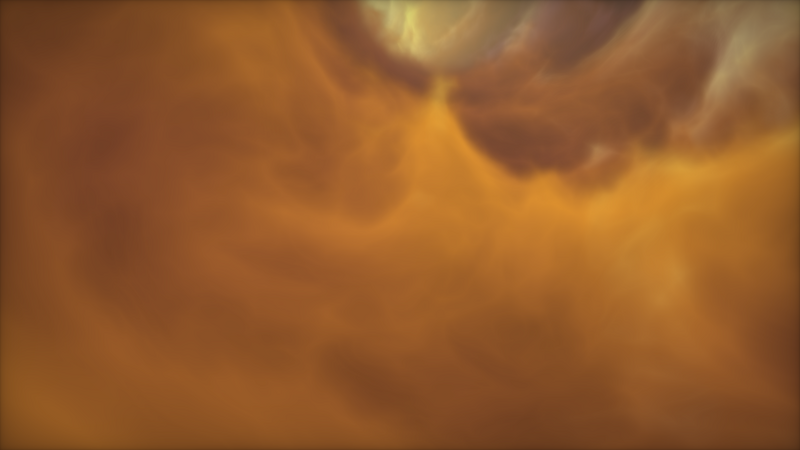
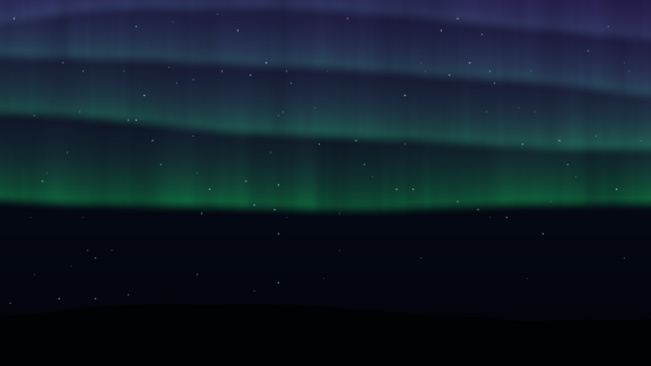

# zzCloud: reverse engineering + shader screensaver builder

1. **Analysis** of `zzCloud.scr`: a 17 MB static Qt 5.15 app wrapping one GLSL shader, nimitz's *Protean clouds*. See **[docs/ZZCLOUD_ANALYSIS.md](docs/ZZCLOUD_ANALYSIS.md)**. The extracted shaders are in [`extracted/`](extracted/).
2. **A builder** that turns any Shadertoy-style shader into a Windows screensaver. It is built on the Direct3D 11 multi-monitor framework from [Screen-Saver-Reverse-Engineering](https://github.com/jawadc13/Screen-Saver-Reverse-Engineering), extended for shader savers.

| zzCloud remake (Ultra) | Aurora Sky (builder example) |
|---|---|
|  |  |

Prebuilt 64-bit savers are in `bin/`: `zzCloud.scr` (remake) and `AuroraSky.scr`. Right-click a saver → **Install**, or copy it to `C:\Windows\System32`.

## Making a screensaver

```sh
# one-time (Ubuntu/WSL): compilers and shader tools
sudo apt install g++-mingw-w64-x86-64 glslang-tools spirv-cross

python3 tools/ssbuild.py new my_saver                    # starter shader + settings
python3 tools/ssbuild.py new my_saver --from cool.glsl   # or start from a Shadertoy shader
# edit shaders/my_saver/shader.glsl and saver.json, then:
python3 tools/ssbuild.py build my_saver                  # -> build/MySaver.scr
python3 tools/ssbuild.py check cool.glsl                 # just check a shader compiles
```

The shader may be a Shadertoy `mainImage(out vec4, in vec2)` or a plain `main()` that writes `gl_FragColor` (the zzCloud style). Available inputs: `iResolution`, `iTime`, `iTimeDelta`, `iFrame`, plus your own sliders. Textures (`iChannel0-3`) are not supported. The builder converts GLSL → SPIR-V → HLSL with glslang and SPIRV-Cross. The HLSL is embedded in the saver and compiled by Windows' `d3dcompiler_47.dll` at start-up.

`saver.json`:

```jsonc
{
  "title": "Aurora Sky",                 // name shown in Windows
  "file": "AuroraSky",                   // -> AuroraSky.scr
  "shader": "shader.glsl",
  "params": [                            // up to 3 sliders; use them in GLSL by name (0..1)
    { "name": "intensity", "label": "Aurora brightness", "default": 50, "low": "Faint", "high": "Vivid" }
  ],
  "defaults": { "quality": "auto", "fps": 60, "monitors": "span", "speed": 50 },
  "speed": { "min": 0.25, "max": 2.0 },  // time multiplier range of the Speed slider
  "icon_colors": ["#30d080", "#081020"]
}
```

`defaults.quality` is `auto|ultra|high|balanced|performance`. `fps` is `30|45|60|90|120|"refresh"`. `monitors` is `span|same|different`. Users can change all of these in the saver's Settings dialog.

## What every built saver gets (tuned for multi-display)

* **One renderer per monitor.** Each monitor renders on its own thread with its own Direct3D 11 device, on the GPU it is plugged into. Each presents with its own flip-model vsync. A 175 Hz ultrawide on one card and a 60 Hz portrait screen on another never wait on each other, and no frames are copied between GPUs.
* **Frame-rate cap** (default 60). Above the cap, the last image is re-shown, which is just a texture copy. A 175 Hz panel then costs no more than a 60 Hz one.
* **Render quality.** *Auto* times the shader on the GPU and adjusts the render scale (25–100%, in 5% steps, rate-limited) so the pass uses about half the frame budget on each monitor. You can also pick a fixed 100/75/50/35%. The image is upscaled from a 10-bit target, so soft gradients don't band.
* **Multiple monitors:**
  * **Span**: one continuous picture across the whole desktop, with each monitor rendering only its own part.
  * **Same**: the same view on every monitor.
  * **Different**: each monitor starts at its own point in the animation.
* MSAA is off for shader savers, since it only costs time on a single full-screen pass.
* From the framework:
  * the standard `/s`, `/p`, `/c` handling and input rules;
  * per-monitor "display nothing";
  * OLED screen care (rest to black, pixel orbit, burn-in guard);
  * Themes & Effects (colour themes, patterns, effects);
  * a frame-time graph (Display Settings).

`build/ScreensaverStudio.exe` (built by `make`) previews every `.scr` in its folder.

## Layout

```
extracted/      shaders pulled out of zzCloud.scr
docs/           ZZCLOUD_ANALYSIS.md, screenshots
shaders/<name>/ builder input: shader.glsl + saver.json   (zzcloud, aurora_sky)
savers/<name>/  GENERATED by ssbuild.py (C++ with embedded HLSL, .rc, .ico)
common/         framework (from Screen-Saver-Reverse-Engineering) + shaderkit.h
                (shader saver runtime) + shader pass in render.cpp
tools/ssbuild.py the builder
studio/         Screensaver Studio
```

## Licence note

The zzCloud shader is nimitz's *Protean clouds*, **CC BY-NC-SA 3.0**. The zzCloud remake can't be used commercially, and copies must credit nimitz. Aurora Sky and the builder are your own.
